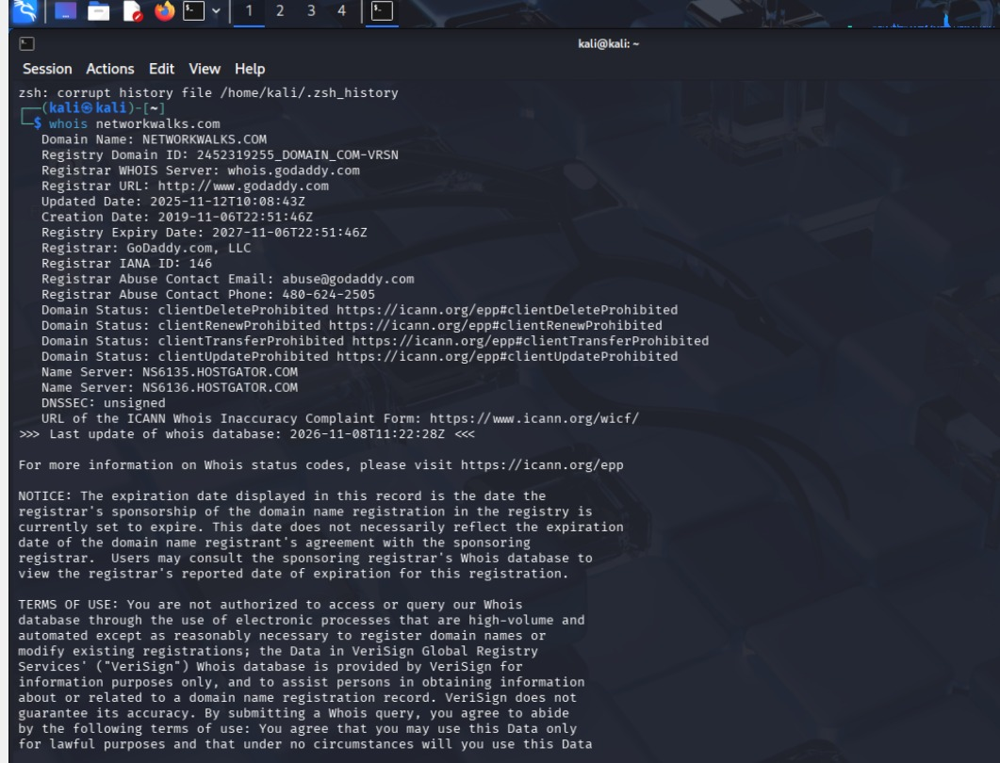
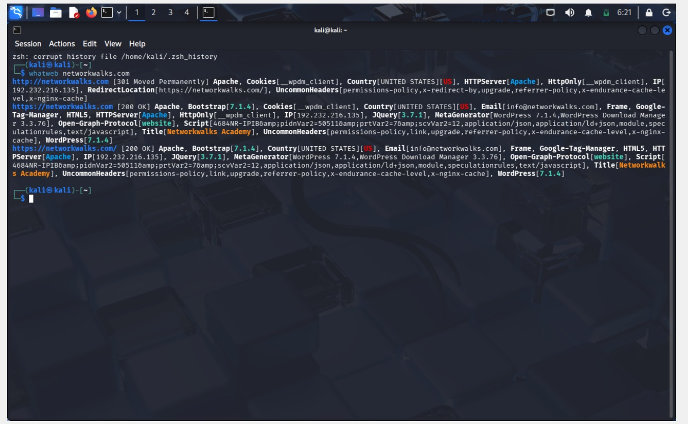
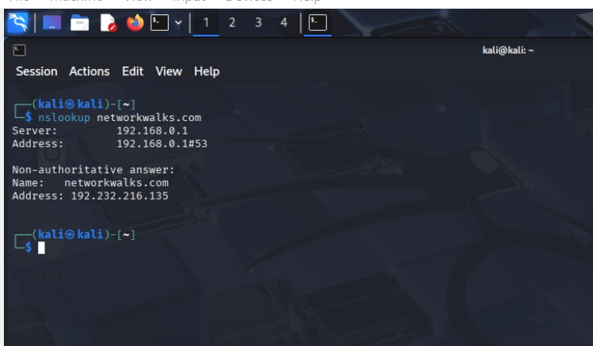
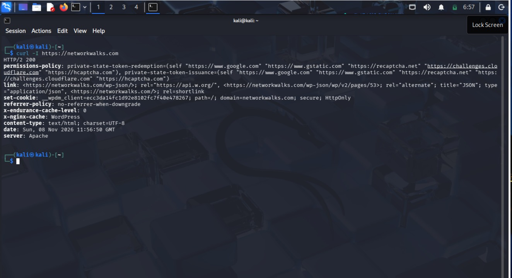
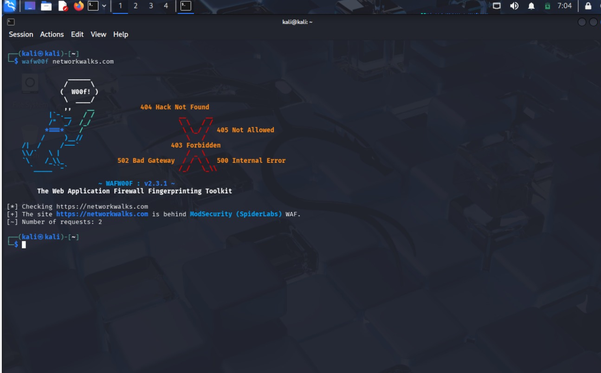
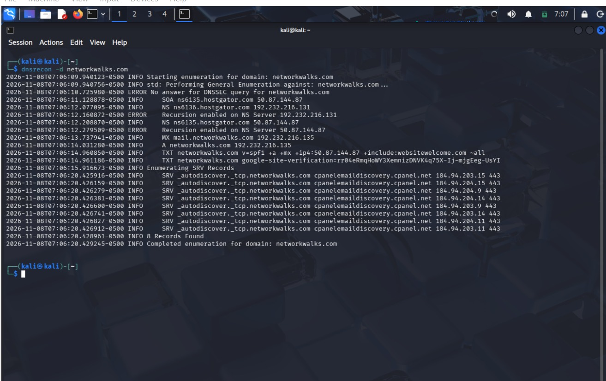

# networkwalk.B084B-week2.cybersercurity-lab-setup
 penetration testing 
 

# WK2-PM2 | CYBERSECURITY | NETWORK WALKS

| **Pentester Name (Cybersecurity Professional)** | **EFOSA OSAWARU** |
|---|---|
| Program/Batch | B084B - NetworkWalks |
| Date | 10th NOvember 2026 |
| Modules Completed | 1. WK2-PM1 (Multiple Kali Tools) |
| | 2. WK2-PM4 (theHarvester Scanning) |
| | 3. WK2-PM5 (Zenmap Scanning) |
| Clear/Target | 1. NetworkWalks (Written permission secured) |
| | 2. My own local LAN network |
| Permission secured from client? | Yes |
| Phases covered | Phase 1: Reconnaissance & Footprinting |
| | Phase 2: Scanning & Network Discovery |
| | Phase 3: In Progress |

---

## Project Overview

This repository documents my cybersecurity learning activities,
reconnaissance exercises, and authorised network assessments.

## Tools Used

- Kali Linux
- theHarvester
- Zenmap
- Nmap
- WAFW00F

## Evidence and Screenshots

Screenshots and findings from authorised exercises will be added here.

## Findings and Recommendations

Document identified findings, their risk levels, and recommended
remediation steps here.

## Conclusion

Summary of completed activities and lessons learned.
