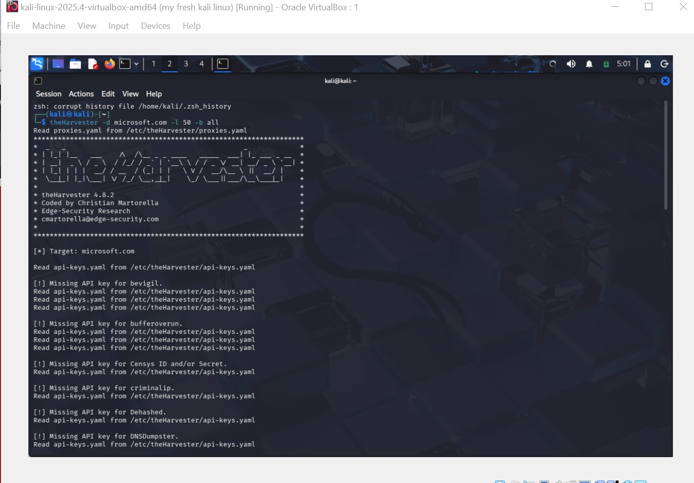

# networkwalk.B084B-week2.cybersercurity-lab-setup
 penetration testing 
 

# WK2-PM2 | CYBERSECURITY | NETWORK WALKS

| **Pentester Name (Cybersecurity Professional)** | **EFOSA OSAWARU** |
|---|---|
| Program/Batch | B084B - NetworkWalks |
| Date | 10th NOvember 2026 |
| Modules Completed | 1. WK2-PM1 (Multiple Kali Tools) |
| | 2. WK2-PM4 (theHarvester Scanning) |
| | 3. WK2-PM5 (Zenmap Scanning) |
| Clear/Target | 1. NetworkWalks (Written permission secured) |
| | 2. My own local LAN network |
| Permission secured from client? | Yes |
| Phases covered | Phase 1: Reconnaissance & Footprinting |
| | Phase 2: Scanning & Network Discovery |
| | Phase 3: In Progress |

---
# 1. Liability Disclaimer
I performed these penetrating testing only on the systems & devices where I had secured written permission or the devices/systems that I own myself. All these materials are for education and research purposes only and not for personal use. Do not use anything from here to break the law. The Instructor, the author(s) and NetworkWalks are not responsible for what you do with this knowledge. Every action you take is for your own responsibility. Misuse of these resources can lead to criminal charges, heavy fines, loss of your job and a permanent criminal record. In most countries unauthorized access is a crime even when nothing is damaged# 2. Introduction

## 2. Introduction
This report expressly covers footprinting the networkwalks.com domain using multiple Kali Linux tools(WK2-PM1) and scanning my own local network with Zenmap (WK2-PM5). Module one covers the footprinting phase while module 5 covers the scanning phase, so together they show how an attacker moves from gathering public information to mapping out live hosts on a computer's network. For the footprinting phase, all commands were run in Kali Linux and for the scanning phase, Zenmap was installed on Windows PC. The steps listed below shows the exact command used, my observation, multiple screenshots as evidence and finally a short note on why the findings matter from an attacker's point of view.

## 3. Tools Used.
This report expressly covers footprinting the networkwalks.com domain using multiple Kali Linux tools(WK2-PM1) and scanning my own local network with Zenmap (WK2-PM5). Module one covers the footprinting phase while module 5 covers the scanning phase, so together they show how an attacker moves from gathering public information to mapping out live hosts on a computer's network. For the footprinting phase, all commands were run in Kali Linux and for the scanning phase, Zenmap was installed on Windows PC. The steps listed below shows the exact command used, my observation, multiple screenshots as evidence and finally a short note on why the findings matter from an attacker's point of view

This table lists each tool used in this project and also its purpose in the project.

| Tool | Purpose |
|---|---|
| Kali Linux & Windows | Operating systems used for reconnaissance (gathering information) activities |
| WHOIS | Used to find domain registration details (owner, dates, name servers, registrar URL) |
| WhatWeb | Fingerprints web technologies (server, email, IP, plugins, CMS) |
| nslookup | Resolves domain names to IP addresses using DNS |
| curl -I | Reads HTTP response headers of the website |
| wafw00f | Detects if a Web Application Firewall protects the site |
| dnsrecon | Highlights DNS records (NS, MX, SRV, SPF, TXT, SOA) |
| theHarvester | Collects publicly available information such as email addresses, subdomains, hostnames, IP addresses and other OSINT data related to a target domain |
## Project Overview

This repository documents my cybersecurity learning activities,
reconnaissance exercises, and authorised network assessments.

## Tools Used

- Kali Linux
- theHarvester
- Zenmap
- Nmap
- WAFW00F

## Evidence and Screenshots

)
## Findings and Recommendations

Document identified findings, their risk levels, and recommended
remediation steps here.

## Conclusion

Summary of completed activities and lessons learned.
